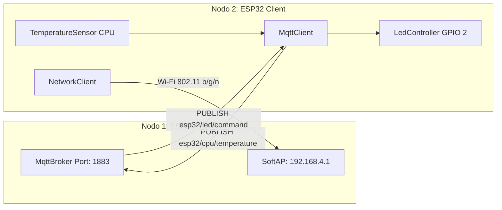

# Sistema Distribuito MQTT per Doppia Scheda ESP32

[](CHANGELOG.md)
[](https://www.espressif.com/)
[](http://mqtt.org/)

Architettura modulare distribuita per due microcontrollori ESP32 operanti in rete wireless locale privata:
* **Nodo 1 (Broker)**: Istanzia un Access Point SoftAP con **IP fisso** (`192.168.4.1`) ed esegue un broker MQTT 3.1.1 leggero integrato.
* **Nodo 2 (Client/Publisher/Subscriber)**: Si connette alla rete privata del broker, pubblica periodicamente la **temperatura interna della propria CPU** su un topic dedicato e ascolta comandi remoti su un topic separato per pilotare il proprio **LED onboard**.

---

## Architettura del Sistema



---

## Struttura della Repository

Il progetto rispetta rigorosamente i criteri di modularità ad oggetti: ciascuna classe risiede nei propri file `.h` e `.cpp`, ed è accompagnata da un file di documentazione `.md` omonimo.

```text
esp32_mqtt_system/
├── CHANGELOG.md                     # Cronologia e versionamento semantico (v1.0.0)
├── README.md                        # Documentazione principale
├── .gitignore                       # Esclusione build e file temporanei
│
├── esp32_broker_node/               # PROGETTO NODO 1: BROKER
│   ├── esp32_broker_node.ino        # Sketch principale di orchestrazione
│   ├── BrokerNetworkManager.h/.cpp  # Gestione Access Point SoftAP con IP statico
│   ├── BrokerNetworkManager.md      # Documentazione della classe BrokerNetworkManager
│   ├── ClientSession.h/.cpp         # Gestione sessioni socket e routing sottoscrizioni
│   ├── ClientSession.md             # Documentazione della classe ClientSession
│   ├── MqttBroker.h/.cpp            # Broker MQTT 3.1.1 con elaborazione pacchetti
│   └── MqttBroker.md                # Documentazione della classe MqttBroker
│
└── esp32_client_node/               # PROGETTO NODO 2: CLIENT
    ├── esp32_client_node.ino        # Sketch principale di telemetria e attuazione
    ├── NetworkClient.h/.cpp         # Connessione e recupero link Wi-Fi
    ├── NetworkClient.md             # Documentazione della classe NetworkClient
    ├── TemperatureSensor.h/.cpp     # Lettura sensore temperatura die interno ESP32
    ├── TemperatureSensor.md         # Documentazione della classe TemperatureSensor
    ├── LedController.h/.cpp         # Driver I/O digitale per LED onboard (GPIO 2)
    ├── LedController.md             # Documentazione della classe LedController
    ├── MqttClient.h/.cpp            # Client MQTT 3.1.1 con callback e ping keep-alive
    └── MqttClient.md                # Documentazione della classe MqttClient
```

---

## Specifiche dei Topic MQTT

| Topic | Ruolo | Direzione | Payload / Formato |
| :--- | :--- | :--- | :--- |
| `esp32/cpu/temperature` | Telemetria | Publisher &rarr; Broker | Valore float espresso in gradi Celsius (es. `45.56`) |
| `esp32/led/command` | Comando | Broker &rarr; Subscriber | Stringhe testuali: `ON`, `OFF`, `TOGGLE`, `1`, `0` |

---

## Convenzioni di Codice Rispettate

* **Variabili**: Notazione `snake_case` (es. `int client_count;`).
* **Funzioni e Metodi**: Notazione `lowerCamelCase` (es. `void startBroker();`).
* **Classi**: Notazione `UpperCamelCase` (es. `class MqttBroker`).
* **Membri Privati**: Prefisso `_` (es. `WiFiClient _socket;`).
* **Costanti & Globali**: Notazione `UPPER_SNAKE_CASE` (es. `const uint16_t BROKER_PORT = 1883;`).
* **Namespaces**: Nessun utilizzo di `using namespace` globale.
* **Auto-commentante**: Commenti di documentazione Javadoc-style su classi e firme dei metodi.

---

## Istruzioni di Caricamento (Flash)

### Nodo 1 (Broker)
1. Connettere il primo ESP32 via USB al computer.
2. Aprire lo sketch `esp32_broker_node/esp32_broker_node.ino` con **Arduino IDE** (oppure compilare via `arduino-cli`).
3. Selezionare scheda **ESP32 Dev Module** e la porta seriale corrispondente.
4. Eseguire l'upload. Il monitor seriale a **115200 baud** confermerà l'avvio della rete `ESP32_MQTT_BROKER_NET` all'indirizzo `192.168.4.1`.

### Nodo 2 (Client)
1. Connettere il secondo ESP32 al computer.
2. Aprire lo sketch `esp32_client_node/esp32_client_node.ino`.
3. Eseguire l'upload sulla relativa porta seriale.
4. Il nodo si aggancerà automaticamente alla rete creata dal Nodo 1 e avvierà la pubblicazione della temperatura CPU ogni 5 secondi, rimanendo in ascolto sul topic del LED.
